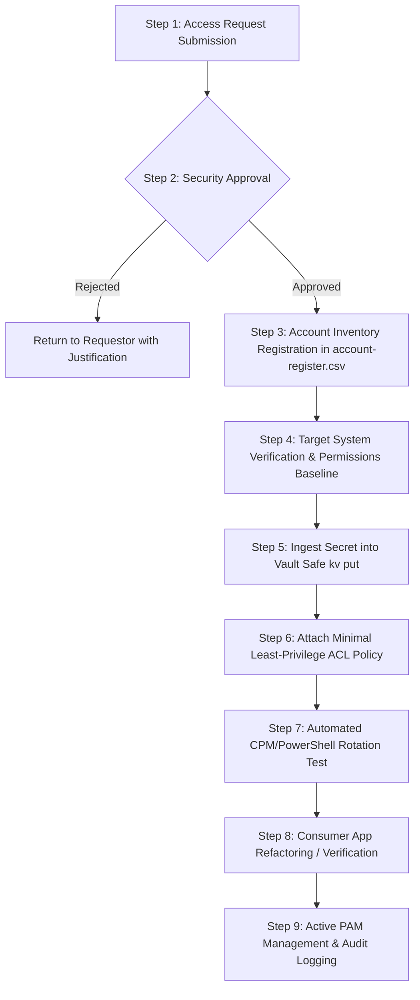

# Privileged Account Onboarding Checklist & Standard Operating Procedure (SOP)

This document defines the formal governance and technical criteria required before any privileged credential is vault-managed within the PAM platform (HashiCorp Vault / CyberArk).

---

## 1. Onboarding Governance Questionnaire

Every privileged account submitted for onboarding must have the following metadata fields validated and registered:

| Field Name | Description | Example / Allowed Values | Required? |
| :--- | :--- | :--- | :--- |
| **Account Name / Identifier** | Username or service identity in the target directory/OS | `svc_webapp`, `Administrator`, `appadmin` | **Yes** |
| **Target System / Hostname** | Fully Qualified Domain Name (FQDN) or cloud ARN | `DC01.lab.local`, `WIN-APP01`, `LINUX01` | **Yes** |
| **Target Safe / Vault Path** | Functional folder path based on tier and scope | `secret/service-accounts/`, `secret/windows-admin/` | **Yes** |
| **Account Owner** | Named engineering lead, manager, or application owner | `@chaitanya`, `identity-eng@lab.local` | **Yes** |
| **Business Purpose** | Specific function why elevated privileges are necessary | "Runs IIS Application Pool for Billing API" | **Yes** |
| **Account Type** | Credential classification | `AD Service Account`, `Windows Local Admin`, `Linux Root/Sudo`, `Cloud IAM User` | **Yes** |
| **Rotation Cadence** | Maximum credential lifespan before automated rotation | `30 days` (standard), `90 days` (cloud IAM), `Emergency/Post-use` | **Yes** |
| **Authorized Retrieve List** | Specific users, roles, or AppRoles allowed to check out / read | `pam-operator`, `webapp-approle` | **Yes** |
| **Formal Approver** | Information Security or Tier-1 PAM Lead approval | Security Manager / PAM Administrator | **Yes** |
| **Privileged Access Review Date**| Recertification deadline (at least quarterly) | `2026-12-31` | **Yes** |
| **Emergency Break-Glass Plan**| Offline recovery procedure if vault is unavailable | Sealed envelope in safe / secondary break-glass account | **Yes** |

---

## 2. Onboarding Workflow (Step-by-Step)



---

## 3. Pre-Onboarding Technical Checklist

- [ ] **Account Existence Verified**: Account exists in AD, target OS, or Cloud provider.
- [ ] **Initial Password Verified**: Validated that current credentials successfully authenticate prior to vault ingestion.
- [ ] **Hardcoding Discovery**: Scanned consumer source code and configuration files for existing hardcoded secrets (to be decommissioned).
- [ ] **Remote Management Enabled**:
  - Windows: WinRM (5985/5986) or RPC/SMB (445) accessible from rotation engine.
  - Linux: OpenSSH (22) accessible from Vault/JumpServer.
  - Active Directory: LDAPS (636) or AD Web Services (9389) open from DC01.
- [ ] **Service Dependencies Documented**: If a service account is bound to Windows Services (`sc.exe`), Scheduled Tasks, or IIS App Pools, list all host instances so the rotation engine can update dependent services.

---

## 4. Post-Onboarding Validation

1. Verify credential retrieval via restricted token:
   ```bash
   VAULT_TOKEN="<operator_token>" vault kv get secret/<safe>/<account>
   ```
2. Verify unauthorized token receives `403 Forbidden`:
   ```bash
   VAULT_TOKEN="<unauthorized_token>" vault kv get secret/<safe>/<account>
   ```
3. Execute dry-run rotation and check `rotation.log`.
4. Register the entry in [`docs/account-register.csv`](file:///docs/account-register.csv).
