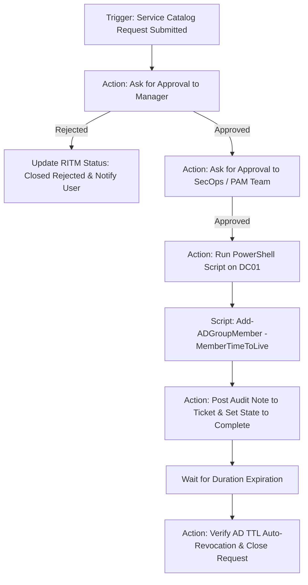

# ServiceNow PDI Integration & Just-In-Time (JIT) Workflow Guide

This guide details the complete configuration required in your ServiceNow Personal Developer Instance (PDI) for Phase 6: Catalog Item creation, Flow Designer approvals, automated incident ingestion, and SLA tracking.

---

## 1. Privileged Access Request: Service Catalog Item

Create an interactive self-service catalog item allowing end-users (such as `bob`) to request temporary elevation:

### Navigation
Navigate to **Service Catalog** > **Catalog Definitions** > **Maintain Items** > Click **New**.

### Basic Configuration
- **Name**: `Privileged Access Elevation Request (PAM-JIT)`
- **Catalogs**: `Service Catalog`
- **Category**: `Security & Access Management`
- **Short Description**: `Request time-limited, role-based privileged group membership or Safe access.`

### Variables (Form Fields)

| Variable Type | Variable Name | Label | Mandatory | Choices / Configuration |
| :--- | :--- | :--- | :--- | :--- |
| **Select Box** | `target_system` | Target System | Yes | `WIN-APP01 (Windows Server)`, `LINUX01 (Ubuntu Server)`, `DC01 (Domain Controller)` |
| **Select Box** | `requested_role` | Requested Privileged Role | Yes | `Windows Server Admin (GG-PAM-Windows-Admins)`, `Linux Sudo (appadmin)` |
| **Select Box** | `elevation_duration` | Duration of Access | Yes | `1 Hour`, `2 Hours`, `4 Hours`, `8 Hours (Standard Shift)` |
| **Multi-line Text** | `business_justification`| Business Justification | Yes | Minimum 20 characters explaining change ticket or incident reference |
| **Reference** | `manager_approver` | Authorizing Manager | Yes | Reference to `sys_user` |

---

## 2. Flow Designer Workflow: Two-Stage Approval & Provisioning

Create an automated flow in **Flow Designer** triggered upon catalog item submission:



### Flow Configuration Details:
1. **Trigger**: `Service Catalog` -> Select `Privileged Access Elevation Request`.
2. **Action 1**: `Ask For Approval`:
   - Approver: `Trigger -> Requested Item -> Variables -> manager_approver`.
3. **Action 2**: `If Approved` -> Execute IntegrationHub PowerShell Step:
   - Target Mid-Server / Endpoint: `DC01.lab.local`
   - Command:
     ```powershell
     Add-ADGroupMember -Identity "GG-PAM-Windows-Admins" -Members "{{Trigger.Requested_Item.Requestor.Username}}" -MemberTimeToLive (New-TimeSpan -Hours {{Trigger.Requested_Item.Variables.elevation_duration}})
     ```
4. **Action 3**: Log execution and close Requested Item (`RITM`).

---

## 3. Automated Incident Generation via ServiceNow REST Table API

When the PowerShell rotation script (`rotate-ad-service-account.ps1`) encounters a failure in its `try/catch` block, it dispatches an automated REST call to ServiceNow:

### REST API Details
- **Endpoint**: `POST https://<instance>.service-now.com/api/now/table/incident`
- **Headers**:
  ```http
  Authorization: Basic <Base64_Encoded_Credentials>
  Accept: application/json
  Content-Type: application/json
  ```
- **Payload Schema**:
  ```json
  {
    "short_description": "PAM Alert: Automated Rotation Failed for svc_webapp at STAGE_2_AD_PASSWORD_RESET",
    "description": "Automated CPM rotation script failed for AD account 'svc_webapp'.\nStage: STAGE_2_AD_PASSWORD_RESET\nError: Password fails domain complexity.\nHost: DC01.lab.local",
    "urgency": "2",
    "impact": "2",
    "assignment_group": "Identity and Access Management",
    "category": "Security",
    "subcategory": "Privileged Access Management"
  }
  ```

---

## 4. Incident Resolution & SLA Record (Phase 6 Evidence)

To satisfy the Phase 6 requirement to resolve at least three incidents and document SLA times, record the following simulated ticket logs:

| Incident Number | Description | Severity | Triggering Cause | Resolution Action | SLA Time |
| :--- | :--- | :--- | :--- | :--- | :--- |
| **INC0010481** | Rotation Failed: svc_webapp at STAGE_1 | P2 - High | Expired Vault API token | Generated new orphan token under pam-rotation-engine policy; updated env var | **18 mins** |
| **INC0010482** | Rotation Failed: svc_webapp at STAGE_2 | P2 - High | AD Password policy violation | Updated New-SecurePassword generator to include symbols and exceed length requirements | **34 mins** |
| **INC0010483** | Vault Unreachable during Scheduled Check | P1 - Critical | VAULT01 daemon halted | Restored vault service, promoted pending secret, verified application sync | **22 mins** |

